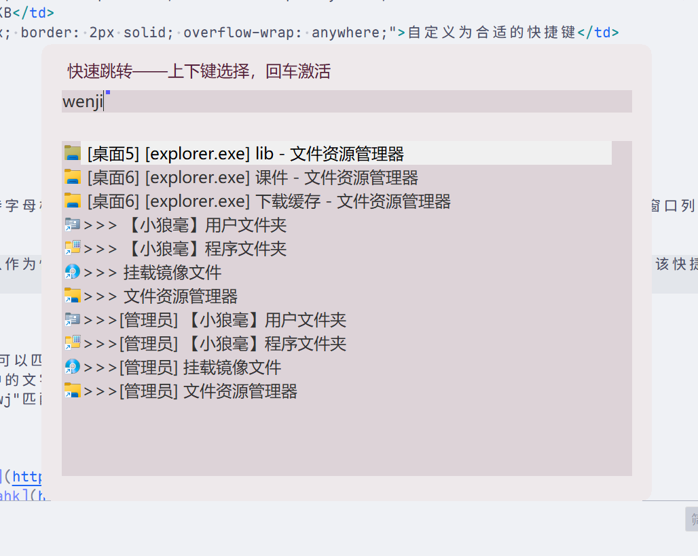

# mykeymap-enhance 更新日志

## 1.17.0

- ✨ feat: 新增半屏组合：先按左右半屏，再在 2 秒内按上下半屏（反过来也可以），窗口落在四分之一屏，`SplitScreen(2, ...)` 与 `Per*AndResizeWindow` 的半屏都参与组合
- 🔨 chore: 九个摆放函数改为共用一份实现
- ✨ feat: 新增窗口贴边函数 `SnapWindow(edge)`，把窗口平移到所在显示器工作区的指定边缘（避开任务栏），只改变位置，宽高不变
- 🐛 fix: 亮度调节改为跟随鼠标所在显示器，按显示器设备名定位，修复笔记本只开外接屏时的下标越界报错
- 🔨 chore: 移除 `NextMonitor()` 与 `PreviousMonitor()`，亮度不再需要先切换显示器

## 1.16.0

该功能现已迁至 VRTX 维护。

- 🎉 feat: 解决了以管理员身份启动普通权限软件时的焦点问题，重新发布 WindowJump

此前的问题：以管理员身份运行时，如何以用户身份启动软件。早期的做法是用 IPC 启动一个独立的启动器进程，软件可以正常启动，但普通软件初次启动时难以获得焦点。现在的做法是把启动任务委托给 Explorer 级别的令牌，同时用 DLL 调用让下一个窗口获得焦点，管理员与普通用户身份下都能正常启动，不再有焦点问题。

## 1.15.0

- 拼音支持开头部分匹配，例如 `jisu` 可以匹配“计算”（jisuan），拼音库 DLL 版本同步更新
- 新增快速切换资源管理器功能 `QuickSwitchExplorer`，可在不同 Explorer 窗口之间切换，也可直接跳转到指定文件夹
- 监听显示器变化并自动重载脚本

## 1.14.0

WindowJump 的启动器功能已经移除，以下为移除原因。若之后出现更合适的实现方式，会重新评估。

- 🔨 chore: 多个函数改为按职责拆分到独立文件
- 📝 docs: 整理注释
- 💥 boom: 彻底移除 WindowJump 的启动器功能：
  - 该功能必须依赖管理员身份才能正常运行，而这样启动的软件全部以管理员身份运行，会带来权限问题与安全隐患
  - 受 AHK 本身的限制，分别以不同权限启动软件非常麻烦
  - 用 IPC 启动独立启动器进程可以做到，但普通软件初次启动时难以获得焦点
  - 该功能的使用场景较少，市面上的启动器可以替代，权衡后决定移除

## 1.13.0

- ⚡️ perf: 优化窗口初始化逻辑，减少启动与切换时的等待
- 📝 docs: 更新旧函数与注释
- 🔨 chore: 重构部分目录结构
- 💥 boom: 自动激活的等待时间由 100 毫秒改为 500 毫秒
- 💥 boom: 窗口边框配色改为从 Windows 强调色自动计算，移除原本的固定色表

## 1.12.1

- ✨ feat: 支持虚拟显示器

## 1.12.0

- ⚡️ perf: 为进程和快捷方式添加图标缓存
- ✨ feat: 扫描系统中的快捷方式，可以作为启动器使用

## 1.11.0

- ✨ feat: 支持拼音匹配与小图标展示

## 1.10.0

- ✨ 新增窗口跳转功能 `WindowJump()`，通过模糊搜索快速切换窗口

## 1.9.0

- ✨ 新增 `SetTaskbarCombine` 函数，用于切换任务栏图标合并模式（始终合并、从不合并）
- ✨ 窗口边框着色功能增强，置顶窗口使用单独的边框颜色，便于识别
- ✨ 置顶窗口失去焦点时保留边框色，标识效果不中断

## 1.8.7

- 🐛 fix: 出错时提前退出

## 1.8.6

- 🔨 chore: 调整工作流

## 1.8.5

- 🐛 fix: 修复亮度获取失败时直接报错的问题

## 1.8.4

- 🐛 fix: 不再激活没有标题的窗口，避免悬浮菜单因失去焦点而消失，例如 Steam 的年龄选择菜单

## 1.8.3

- 🐛 修复变量初始化问题

## 1.8.2

- ✨ 窗口吸附默认关闭，传入正值参数才启用，避免默认开启带来的开销

## 1.8.1

- 🐛 修复鼠标长按时仍会自动激活窗口的问题。复制文字时可以把鼠标自由移开

## 1.8.0

- ✨ 窗口拖动与调整大小新增吸附功能，支持吸附到工作区边缘与其他窗口边缘

## 1.7.0

- ✨ 拖动或调整大小时，光标形状随操作区域变化
- ✨ 解决了与其他 AHK 光标管理软件的兼容性问题，如 InputTip，恢复光标时不再覆盖其他软件的设置

## 1.6.3

- 🐛 修复自动激活导致的闪烁问题 <https://www.autohotkey.com/docs/v2/lib/_WinActivateForce.htm>

## 1.6.2

- 🔨 chore: 常规更新

## 1.6.1

- 🐛 修复 Windows 10 上右键菜单消失的问题
- ✨ 新增若干实验性函数，默认不加载

## 1.6.0

- ✨ 加入 Logger 模块，方便调试和开发
- 💄 优化边框颜色
- 🐛 引入 Logger 后，修复了多处此前未暴露的问题
- ✨ 未访问窗口使用强调色的补色边框，鼠标移上去后改为强调色

## 1.5.0

- ✨ 新增平滑滚动模拟功能 `SmoothScrollSimulate()`，可以以像素为单位滚动，支持水平、垂直与对角线方向，细节见 README

## 1.4.0

- ✨ 建立容错机制：从任务栏手动切换程序时，被激活的窗口会被加入未访问列表，自动激活功能随之停用，直到鼠标移到该窗口上

默认轮询时间在该版本调整为 50 毫秒。如需修改，可在调用 `AutoActivateWindow` 时传入 `pollingTime` 参数。

## 1.3.3

- 💥 自动激活的容错时间仍为 50 毫秒，破坏性说明见 1.3.0

## 1.3.2

- 💥 自动激活的容错时间仍为 50 毫秒，破坏性说明见 1.3.0

## 1.3.1

- 💥 自动激活的容错时间仍为 50 毫秒，破坏性说明见 1.3.0

## 1.3.0

- 💥 自动激活的容错时间缩减为 50 毫秒。该版本已经建立了其他容错机制，触发可以更灵敏，以适应更多情况

该更新具有一定的体验破坏性，建议评估后再升级。

若感觉激活过于灵敏，可以调整 `ActivateWindowUnderMouse` 的 `timeoutInput`。

## 1.2.1

特性说明见 1.2.0。

## 1.2.0

当识别到存在鼠标从未移入过的窗口时，自动激活功能会停用；访问过该窗口后自动恢复。

## 1.1.3

此版本用于测试自动构建，没有代码改动。

## 1.1.2

此版本用于测试自动构建，没有代码改动。

## 1.1.1

此版本用于测试自动构建，没有代码改动。

## 1.1.0

初始版本。

## 1.0.1

初始版本。

## 1.0.0

初始版本。