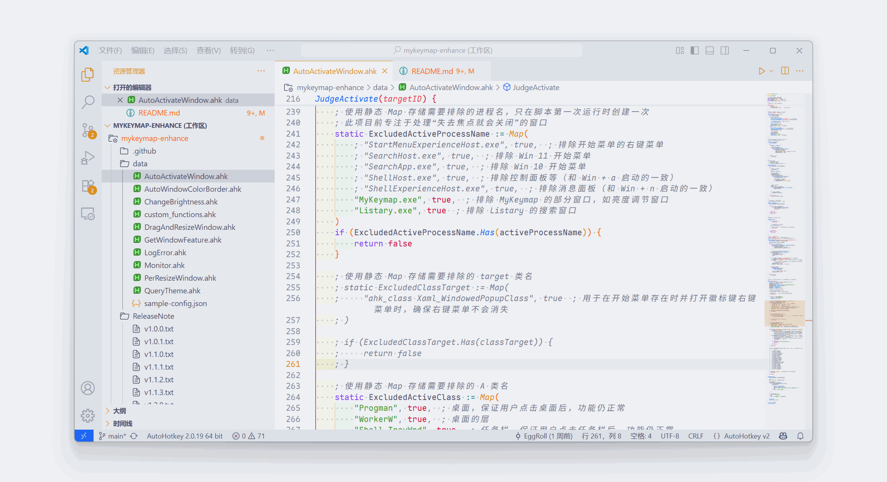
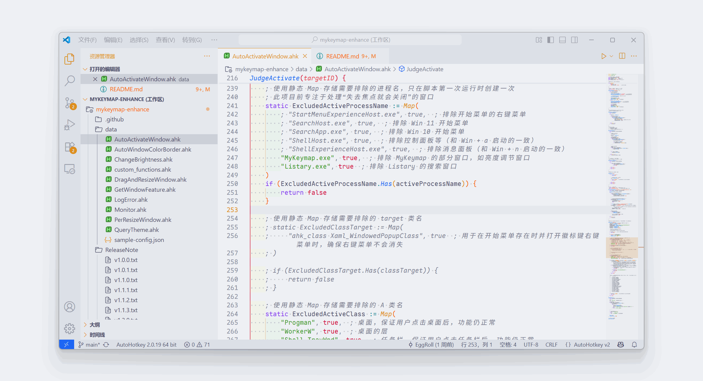
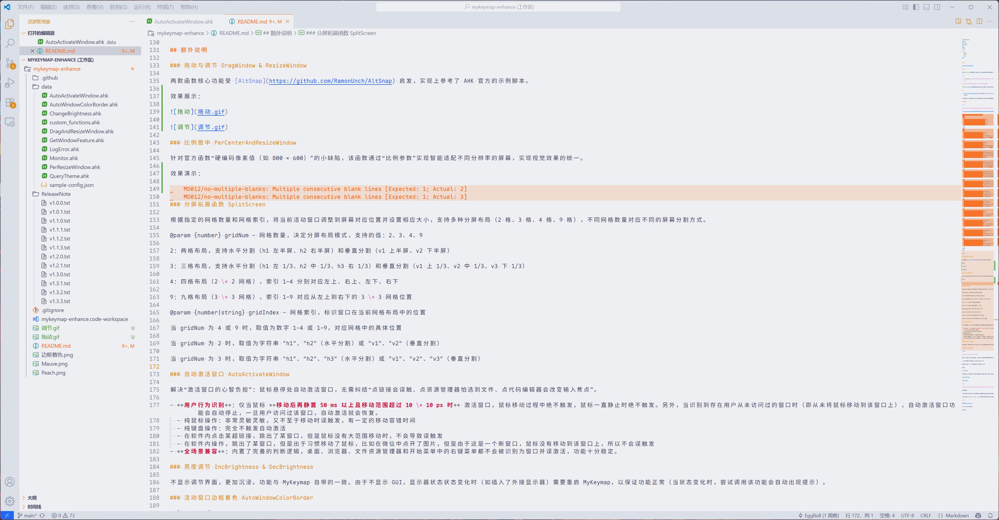
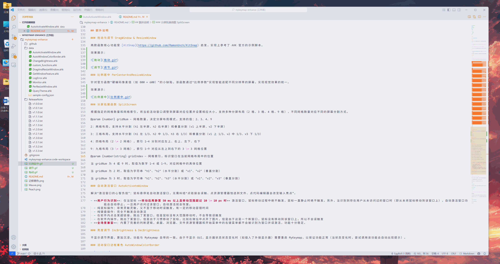
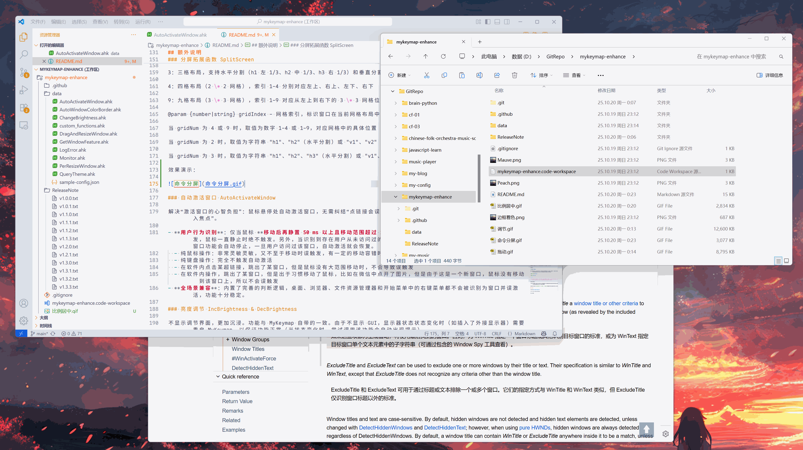
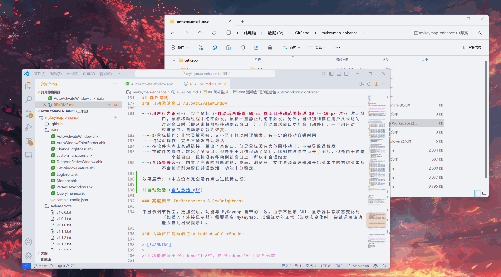

## 仓库地址

<https://github.com/Jy-EggRoll/mykeymap-enhance/>

## 使用方法

下载 Release 中的 `data.zip`，解压后把各子文件放入 MyKeymap 的 `data` 目录，之后即可在 MyKeymap 中调用这些函数。

> [!WARNING]
>
> 本项目所有脚本均需要使用 **AutoHotkey v2** 运行。

> [!TIP]
>
> 从 1.4.0 版本开始，不再提供示例 JSON 配置，改为在本文给出各函数的配置建议，减少配置冲突。

`custom_functions.ahk` 只保留与官方一致的接口，负责导入各模块，本身不提供实际功能。其中包含显示器变化后自动重载等额外逻辑。

使用全部功能只需加入它已经 `#Include` 的模块。`DebugLib/` 与 `Deprecated/` 不在加载范围内：`DebugLib/GetWindowFeatureGUI.ahk` 在加载时会立即弹出调试窗口并注册全局热键，不要一并放入。没有自己的自定义函数时可以直接覆盖 `custom_functions.ahk`；若已有自己的自定义函数，请对比两个文件后再合并。

## 引言

本项目收集一些在 MyKeymap 之外编写的 AutoHotkey 功能，全部无需依赖 MyKeymap 即可运行，也可以直接由 AHK 调用。

推荐通过 MyKeymap 调用这些函数，其中一部分内置了特定场景的快捷键。其余函数若要直接由 AHK 调用，需要在代码里自行分配快捷键。

## 自定义函数表

下表列出全部函数及其参数、功能与配置建议。表格比较宽，在窄屏或手机端浏览时可能超出屏幕，需要横向拖动才能看全。

| 函数名 | 参数 | 功能 | 最佳实践 |
| --- | --- | --- | --- |
| `SmoothScrollSimulate()` | 无参数 | 模拟平滑滚动，触发时以像素为单位滚动，效果接近触摸板或触摸屏，支持左右移动与对角线移动。浏览器等多数现代软件可用，Windows 文件资源管理器等少数软件不支持 | 绑定到前置键 + 鼠标右键（必须是右键，否则需要修改代码），例如 <kbd>Win</kbd> + 鼠标右键 |
| `DragWindow(snapThreshold := 0, edgeOnly := true)` | `snapThreshold`：吸附阈值，单位像素，0 表示关闭吸附 `edgeOnly`：是否只吸附工作区边缘，默认 true | 按住触发键在任何位置点击即可拖动窗口，无需点击标题栏。在最大化窗口上调用时，窗口先变为占满整个工作区的普通窗口 | 绑定到前置键 + 鼠标左键（必须是左键，否则需要修改代码），例如 <kbd>Caps</kbd> + 鼠标左键 |
| `ResizeWindow(snapThreshold := 0, edgeOnly := true)` | `snapThreshold`：吸附阈值，单位像素，0 表示关闭吸附 `edgeOnly`：是否只吸附工作区边缘，默认 true | 无需定位到边框就能调整窗口大小，窗口分为 9 个区域，拖动对应区域完成调节。在最大化窗口上单击（不移动鼠标）会先变为占满工作区的普通窗口；按住并拖动则提示先单击，避免闪烁 | 绑定到前置键 + 鼠标右键（必须是右键，否则需要修改代码），例如 <kbd>Caps</kbd> + 鼠标右键 |
| `ScaleWindow(percent)` | 缩放比例增量，如 0.1 表示放大 10%，-0.1 表示缩小 10% | 按比例缩放当前窗口，以窗口中心为基准。最大化或最小化窗口不生效 | 自定义为合适的快捷键 |
| `PerCenterAndResizeWindow(percentageW, percentageH)` | 小数，宽度占工作区的比例（0-1），高度占工作区的比例（0-1） | 按工作区比例设置窗口大小并居中，换分辨率后视觉效果一致 | 自定义快捷键 |
| `Per*AndResizeWindow(percentageW, percentageH)` | 小数，宽度占工作区的比例（0-1），高度占工作区的比例（0-1） | `*` 替换为 Left、Down、Right、Up、LeftUp、LeftDown、RightUp、RightDown，负责分屏与边角摆放；左右半屏与上下半屏连着按两次会合成四分之一屏，详见下文“半屏组合成四分之一屏” | 前四个功能完全替换默认的 <kbd>Win</kbd> + 方向键，后四个替换为合适的快捷键 |
| `SnapWindow(edge)` | Left、Right、Up、Down 之一，表示贴到哪条边 | 把当前窗口平移到所在显示器工作区的对应边缘（已避开任务栏），只改变位置，宽高保持不变。最大化或最小化窗口不生效，会提示先还原 | 绑定到前置键 + <kbd>Shift</kbd> + 方向键，例如 <kbd>Caps</kbd> + <kbd>Shift</kbd> + 方向键 |
| `SplitScreen(gridNum, gridIndex)` | `gridNum`：网格数量，取 2、3、4、9 `gridIndex`：网格索引，取值见下文 | 按网格数量与索引把窗口摆到工作区的对应位置并设置大小，支持 2、3、4、9 格分屏 | 使用 MyKeymap 的命令实现分屏，如 41、92 |
| `AutoActivateWindow(pollingTime := 20)` | `pollingTime`：轮询时间（毫秒），默认 20 | 开关函数。鼠标移动后停下即激活所在窗口，无需点击。默认随 MyKeymap 启动 | 绑定一个快捷键或指令，方便随时启停 |
| `IncBrightness(delta)` | 亮度增量，整数，如 5 表示在当前亮度上提高 5 个百分点 | 提高鼠标所在显示器的亮度 | 自定义为合适的快捷键或指令 |
| `DecBrightness(delta)` | 亮度增量，整数，如 5 表示在当前亮度上降低 5 个百分点 | 降低鼠标所在显示器的亮度 | 自定义为合适的快捷键或指令 |
| `QuickSwitchExplorer()` | 无参数 | 快速切换或跳转到资源管理器窗口，在打开、保存对话框中调用会弹出已打开的 Explorer 列表供选择。 实验性功能，稳定性未经验证，不建议日常使用；默认未加载，需自行 `#Include` | 不建议使用 |
| `AutoWindowColorBorder(pollingTime := 20)` | `pollingTime`：轮询时间（毫秒），默认 20 | 开关函数。为活动窗口添加彩色边框：未访问、置顶与弹出窗口用强调色的补色，已访问的普通窗口用强调色。默认随 MyKeymap 启动 | 绑定一个快捷键或指令，方便随时启停 |
| `BlockSend(text)` | 文本内容 | 将文本写入剪贴板并粘贴到光标位置，粘贴后恢复剪贴板的原内容 | 自定义为合适的快捷键 |
| `BlockSendFile(filePath, blockSize := 2000, interChunkDelay := 200, maxFileBytes := 10 * 1024 * 1024)` | `blockSize`：每块字符数，默认 2000 `interChunkDelay`：块与块之间的间隔（毫秒），默认 200 `maxFileBytes`：文件大小上限（字节），默认 10 MB，传 0 表示不检查 | 按块读取文件内容并逐块粘贴到光标位置，块与块之间按间隔等待；文件按 UTF-8 读取，文件不存在、无法打开或超过大小上限时提示并终止 | 自定义为合适的快捷键 |
| `SetTaskbarCombine(mode := "")` | 可选 `"Always"`（始终合并）或 `"Never"`（从不合并），为空则自动翻转 | 切换所有显示器的任务栏图标合并状态，无需重启资源管理器 | 自定义为合适的快捷键或指令 |
| `ReadFileToInput(filePath)` | 文件路径 | 读取文件内容并输入到光标位置，适用于密码这类不便直接粘贴的文本；要求单行文本，不超过 10 KB。位于 `Deprecated/` 目录下，默认未加载，需自行 `#Include` | 自定义为合适的快捷键 |

## 功能详解

### 窗口跳转（已迁出到 VRTX）

窗口跳转功能已迁移到独立软件 [VRTX](https://github.com/Jy-EggRoll/vrtx) 维护。本仓库在 1.16.0 之后已移除相关代码，如需该功能请前往 VRTX。

> [!TIP]
>
> 该功能的拼音匹配由 [IbPinyinLib](https://github.com/Chaoses-Ib/ib-matcher) 提供，虚拟桌面窗口识别由 [VD.ahk](https://github.com/FuPeiJiang/VD.ahk) 提供，相关代码与其依赖库已随功能一起迁往 VRTX。

### 拖动与调节 DragWindow & ResizeWindow

这两个函数的核心功能受 [AltSnap](https://github.com/RamonUnch/AltSnap) 启发，实现上参考了 AHK 官方的示例脚本。

- **DragWindow**：按住触发键在任何位置点击即可拖动窗口，无需点击标题栏
- **ResizeWindow**：将窗口划分为 9 个区域（左上、上、右上、左、中、右、左下、下、右下），拖动对应区域即可调整大小
- **吸附**：拖动或调整大小时，窗口边缘会吸附到工作区边缘和其他窗口的边缘。吸附阈值由 `snapThreshold` 控制，0 表示关闭；`edgeOnly` 为 true 时只吸附工作区边缘

效果展示：

### 比例居中 PerCenterAndResizeWindow

官方函数按固定像素设置窗口大小，如 800 × 600，换分辨率后观感不一致。本函数改用占工作区的比例，换分辨率后观感一致。

效果演示：

### 分屏拓展函数 SplitScreen

根据指定的网格数量与网格索引，将当前活动窗口摆到工作区的对应位置并设置相应大小。

`gridNum` 取 2、3、4、9：

- 2：`h1` 左半屏、`h2` 右半屏，`v1` 上半屏、`v2` 下半屏
- 3：`h1`、`h2`、`h3` 为左、中、右各 1/3 宽，`v1`、`v2`、`v3` 为上、中、下各 1/3 高
- 4：2 × 2 网格，索引 1-4 依次为左上、右上、左下、右下
- 9：3 × 3 网格，索引 1-9 从左上到右下依次排列

`gridNum` 为 2 或 3 时，`gridIndex` 传字符串；为 4 或 9 时，传数字。

效果演示：

### 半屏组合成四分之一屏

左右半屏与上下半屏可以连着按：先按左或右半屏，再按上或下半屏，窗口就会落在那一半里的四分之一角落。反过来先按上下再按左右，结果相同。落点固定是工作区的一半宽、一半高。

- `SplitScreen(2, "h1")`、`"h2"`、`"v1"`、`"v2"` 与 `Per*AndResizeWindow` 里的左右、上下半屏是同一件事，都会参与组合
- 先左后上与先上后左都得到左上，其余三个角落同理，与按键顺序无关
- 两次按键默认要在 2 秒内完成，超时就当两次互不相关的半屏
- 只对同一个窗口生效，中间换成别的窗口就不会组合
- 只有铺满整条边的半屏参与组合；1/3、1/9、4 格这类分屏不参与，仍然直接定位到对应格子，同时清掉已经开始的序列
- 组合只看按键序列：中途用 `SnapWindow` 贴边，或用鼠标拖动普通窗口，都不会打断已经开始的序列
- 连按两次就结束，合成四分之一屏之后再按方向键，又回到普通的半屏
- 组合间隔由代码中的 `SplitChain.timeoutMs` 控制（毫秒），设为 0 即关闭组合

### 窗口贴边 SnapWindow

把当前窗口贴到所在显示器工作区的某条边上（左右上下），**只移动位置，不改变窗口大小**。

与 `Per*AndResizeWindow` 系列的区别在于：那些函数会按比例重新设定窗口的宽高，用来做分屏排版；`SnapWindow` 保留窗口当前的宽高，只把它推到边上，适合窗口已经大小合适、只差挪个位置的场景。

- 贴的是**工作区边缘**，也就是已经避开任务栏的区域，贴上去不会压在任务栏底下
- 四边可以分别绑定快捷键，也可以只绑其中两条
- 目标显示器取窗口中心所在的那台显示器，多显示器下不需要额外指定
- 方向参数**区分大小写**，只能写成 Left、Right、Up、Down 这种首字母大写的形式，写成其他形式会提示参数错误
- 窗口处于最大化或最小化状态时不生效，会提示先还原；之所以不自动还原，是因为还原会改变窗口尺寸，与“不改变大小”的约定冲突

**最佳实践**：

- 建议绑定为前置键 + <kbd>Shift</kbd> + 方向键，与 `Per*AndResizeWindow`（建议占用前置键 + 方向键）形成互补：前者调整大小，后者只挪位置
- 只常用某一两条边时，可以只绑这两个方向，减少按键记忆负担

### 自动激活窗口 AutoActivateWindow

鼠标停留处的窗口会被自动激活，不必先点击，用于省去频繁手动切换窗口的操作。

- **触发条件**：鼠标移动后，系统输入空闲满 100 毫秒（`A_TimeIdle`，键盘输入同样计入），且相对上次记录的位置在任一方向偏移超过 10 像素，才激活窗口。鼠标移动过程中不触发，鼠标一直静止也不触发
  - 纯键盘操作本身不会触发激活，但会推迟判定：打字停下后，若上一次鼠标移动的位移还没有被消费，仍会激活鼠标下的窗口
  - 在软件内点击链接弹出新窗口、鼠标没有大范围移动时，不会误触发
  - 在微信里打开图片这类新窗口时，只要鼠标没有移到新窗口上，就不会误激活
- **按住鼠标左键或右键期间不激活**，复制文字时可以把鼠标自由移开
- **未访问窗口**：焦点切换由下一轮轮询发现，新的前台窗口被标为未访问，非前台的未访问窗口则被改回已访问，所以同一时刻最多只有一个未访问窗口，也就是前台那个。鼠标不在前台窗口上时，功能整体停用，按下鼠标左右键也不触发；把鼠标移到该窗口上即恢复
  - 从任务栏手动切换或通过窗口列表切换出来的窗口，会计入未访问
- **排除的窗口**：没有标题的窗口、不可见或属于子窗口的窗口、被 DWM 隐藏的预加载窗口、既不能调整大小也不带最大化与最小化按钮的窗口，都不会被判定为可激活窗口。桌面、任务栏、设置窗口、右键菜单、开始菜单弹出层与脚本自身的界面同理

效果展示（全程未点击鼠标左键）：

### 亮度调节 IncBrightness & DecBrightness

调节时不弹出界面，亮度直接变化。亮度跟随鼠标所在的显示器，不需要先切换显示器。

调节的是显示器自身的亮度，不是软件层面的调暗。显示器不支持这类调节指令时，改为调节内置显示器的背光，提示中会标出“内置屏”。

显示器配置变化时（如插入或拔掉外接显示器），`data/custom_functions.ahk` 里监听 `WM_DISPLAYCHANGE` 的那段逻辑会自动重载脚本，无需手动重启。重载完成之前的短暂时间里，调节会被拦下并提示稍后重试。

### 活动窗口边框着色 AutoWindowColorBorder

> [!WARNING]
>
> 此功能依赖 Windows 11 的 DWM API，在 Windows 10 上**完全无效**。

为活动窗口添加彩色边框，与自动激活窗口配合，便于分辨当前激活的窗口。

**颜色规则**：饱和度固定为 100%，亮度固定为 50%，只有色相随窗口状态变化。

- 未访问窗口、置顶窗口、弹出窗口：强调色的补色，即色相偏移 180 度
- 已访问且非置顶的普通窗口：强调色本身
- 失去焦点时：非置顶窗口清除边框，置顶窗口保留边框

边框颜色由强调色算出，没有可配置的颜色列表。

### 任务栏图标合并 SetTaskbarCombine

修改注册表并广播 `WM_SETTINGCHANGE`，切换所有显示器的任务栏图标合并状态，无需重启资源管理器。

- **Always**：始终合并图标
- **Never**：从不合并图标
- 空参数：在合并与不合并之间翻转

### 平滑滚动模拟 SmoothScrollSimulate

按住鼠标右键并移动，模拟现代软件中的平滑滚动。支持：

- 垂直滚动
- 水平滚动
- 对角线移动

### 文件快速输入 ReadFileToInput

读取文件内容并输入到光标位置，适用于密码这类不便直接粘贴的文本。

该函数位于 `Deprecated/` 目录下，不在 `custom_functions.ahk` 的默认加载范围内，使用时需要在脚本中自行 `#Include`。

**限制**：

- 仅支持单行文本，含换行符的文件会被拒绝
- 文件不超过 10 KB（10240 字节）
- 按 UTF-8 解码

## 额外工具

### GetWindowFeatureInfo & GetWindowFeatureGUI

`DebugLib/` 目录下有一套独立的窗口信息查看与调试工具，可以查看窗口的标题、位置、类名、控件名等详细信息，用于开发和调试。这些工具不在 `custom_functions.ahk` 的默认加载范围内，如需使用，请在脚本中手动加载。

## 关于作者

个人网站：<https://eggroll.pages.dev/>

也欢迎浏览作者在 GitHub 上的其他项目。

## 统计

